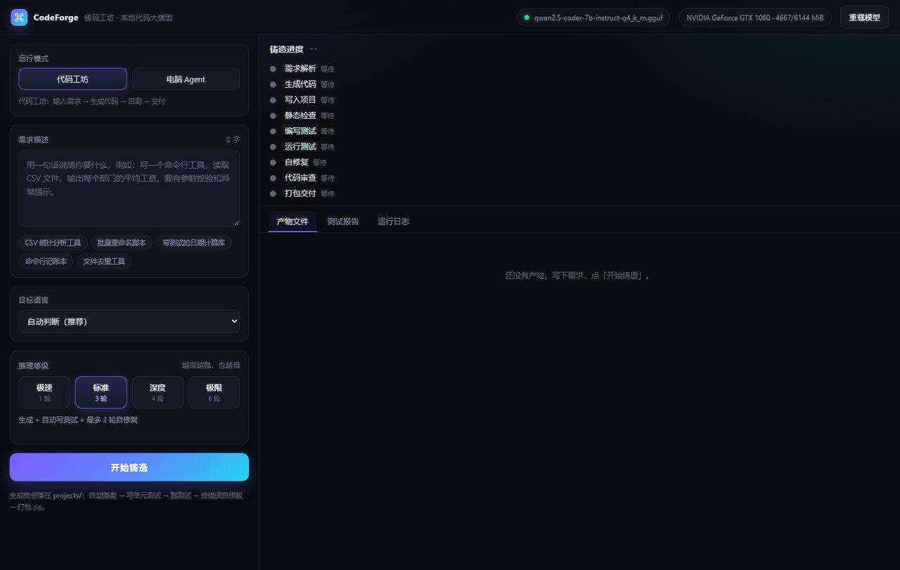
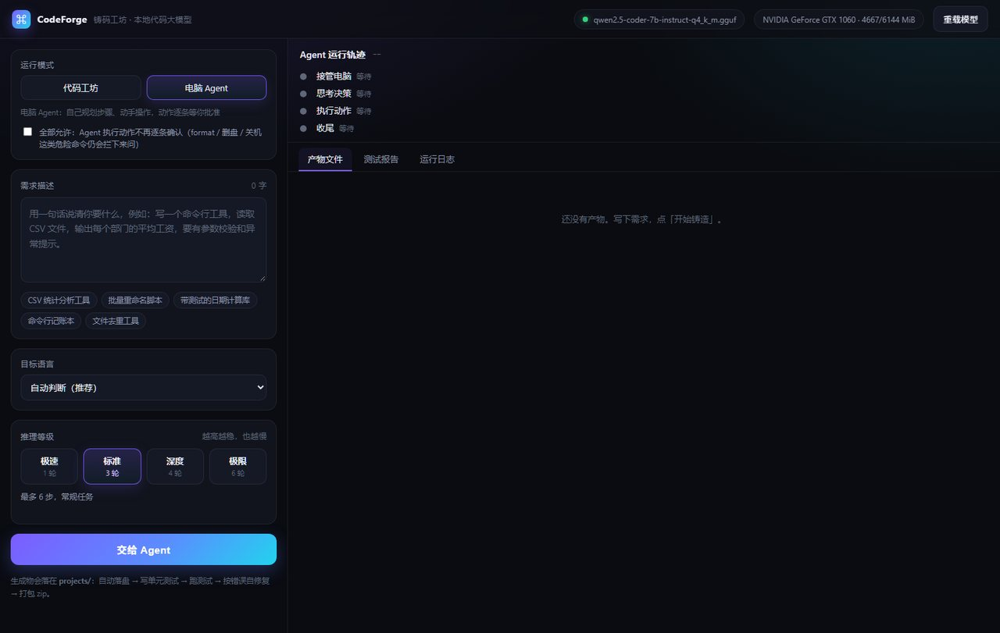

# CodeForge · 铸码工坊

**完全本地运行的 AI 代码工坊 + 电脑 Agent**：不接任何 API，模型跑在你自己显卡上（llama.cpp + Qwen2.5-Coder），代码不出本机，断网照样用。

输入一句需求，它自己走完 **生成代码 → 静态检查 → 写单元测试 → 跑测试 → 按报错自修复 → 打包交付**；切到「电脑 Agent」模式，同一个模型就变成在你注视下动手干活的助手。

[](https://github.com/zgs7157/CodeForge/releases/latest)
[](LICENSE)
[](#系统要求)

**下载：[CodeForge-Setup.exe（50.8 MB）](https://github.com/zgs7157/CodeForge/releases/latest/download/CodeForge-Setup.exe) · 网页版（免安装）：[打开网页版](https://4mkp9kkvkdfeh.doubaoapps.com/app/app_17ju6y5tx97) · [官网与下载页](https://zgs7157.github.io/CodeForge/)**

> 网页版跑在云端，不依赖你的电脑；填「名字 + 密码」即可登录，名字全局唯一，重名会被直接拒绝注册/登录。生成记录存服务端，换设备登录也能看到。



---

## 能干什么

| 能力 | 说明 |
|---|---|
| 代码铸造 | 需求 → 文件树 + 可运行项目 + zip；模型只输出「文件名 + 代码块」，本地解析，不靠 JSON |
| 自动测试 | 让模型写 unittest 并真跑；失败日志回喂模型重写，最多 5 轮；漏 import 走确定性机械修复 |
| 四档推理等级 | 极速（1 轮无测试）/ 标准（1 轮带测试）/ 深度（2 候选择优 + 审查）/ 极限（3 候选 + ≥8 用例 + 边界强化） |
| 电脑 Agent | ReAct 循环，动作：`shell` / `write_file` / `read_file` / `list_dir` / `run_python` / `open_path` / `finish` |
| 审批闸门 | 每个动作先展示原命令，拒绝 / 允许 / 允许并全部允许；黑名单命令即使全允许也单独确认 |
| 悬浮窗 | 置顶小卡片实时显示目标、当前动作、第 N/M 步、进度条、已用时；双击开主界面 |
| 模型库 | 探测显存 / 内存 / 磁盘，7 个候选打分排序，一键从 ModelScope 下载并热切换、校验加载成功 |
| 安装程序 | tkinter 向导 + 单文件 exe，探硬件 → 推荐模型 → 解包 → 下载 → 快捷方式 → 卸载项 |



## 快速开始

### 用安装包（推荐）

1. 下载 [CodeForge-Setup.exe](https://github.com/zgs7157/CodeForge/releases/latest/download/CodeForge-Setup.exe)
2. 运行，向导会自动选中适合你显存的模型
3. 完成后从桌面「CodeForge 铸码工坊」启动，等指示灯变绿

> SmartScreen 会提示「未知发布者」（未做代码签名），点「更多信息 → 仍要运行」。

### 从源码跑

需要：Windows 10/11、Python 3.11+、[llama.cpp Vulkan 版](https://github.com/ggml-org/llama.cpp/releases) 的 `llama-server.exe` 及其 DLL、一个 GGUF 模型。

```
CodeForge/
├─ llama/llama-server.exe + *.dll      ← 自行下载 llama.cpp Vulkan 包解压到这
├─ models/xxx.gguf                     ← 任意 Qwen2.5-Coder / DeepSeek-Coder GGUF
├─ config.json                         ← 见 config.example.json
└─ app/                                ← 本仓库源码
```

```bat
py -3.13 app\server.py
:: 打开 http://127.0.0.1:8765
```

打安装包：

```bat
py -3.13 installer\_build.py
:: 产出 installer\dist\CodeForge-Setup.exe
```

## 结构

```
app/server.py      本地 HTTP 服务（8765）：任务调度、SSE 推送、审批、HUD、模型切换路由
app/forge.py       铸造管线：生成 / 静态检查 / 测试对齐 / 自修复 / 打包
app/agent.py       电脑 Agent：ReAct 循环 + 审批 + 危险命令黑名单 + 报告留痕
app/llm.py         引擎进程管理（含端口占用清理）、推理调用、模型预热
app/catalog.py     硬件探测 + 模型候选打分 + ModelScope 下载 + 切换配置
app/hud.py         tkinter 悬浮窗（DPI 感知、置顶可拖、单实例锁）
app/web/index.html 单文件深色 GUI
installer/         tkinter 安装向导 + PyInstaller 打包脚本
docs/              GitHub Pages 官网与下载页
```

## 系统要求

- Windows 10 / 11 x64
- NVIDIA 独显，**6G 显存起**（4G 可跑 3B；纯 CPU 能跑但很慢）
- 8 GB 内存起（16 GB 更稳），约 12 GB 磁盘
- 仅首次下载模型需要网络

## 设计取舍（如实说明）

- **7B 不是神医**：它偶尔会把测试断言写错。管线会先做测试对齐、机械修 import、再回喂错误多轮修复，最后按实际行为做断言快照对齐——这类绿色会标「弱验证」。仍不绿就明确标 ⚠ 测试未全绿，不假装通过。
- **完整测试闭环只在 Python 上**：Node 走 `node --check` + 冒烟运行，网页只做静态检查。
- **Agent 也受 7B 限制**：复杂任务会绕圈或漏步骤；步数预算（4/6/9/12）用完会如实报「达到步数上限」。适合几十秒级明确小任务，不适合一口气重构整个工程。
- **审批卡是最后一道闸**：勾「全部允许」等于把命令执行权交出去（黑名单除外）。不放心就别勾。

## 许可

[MIT](LICENSE) © 2026 zgs7157
